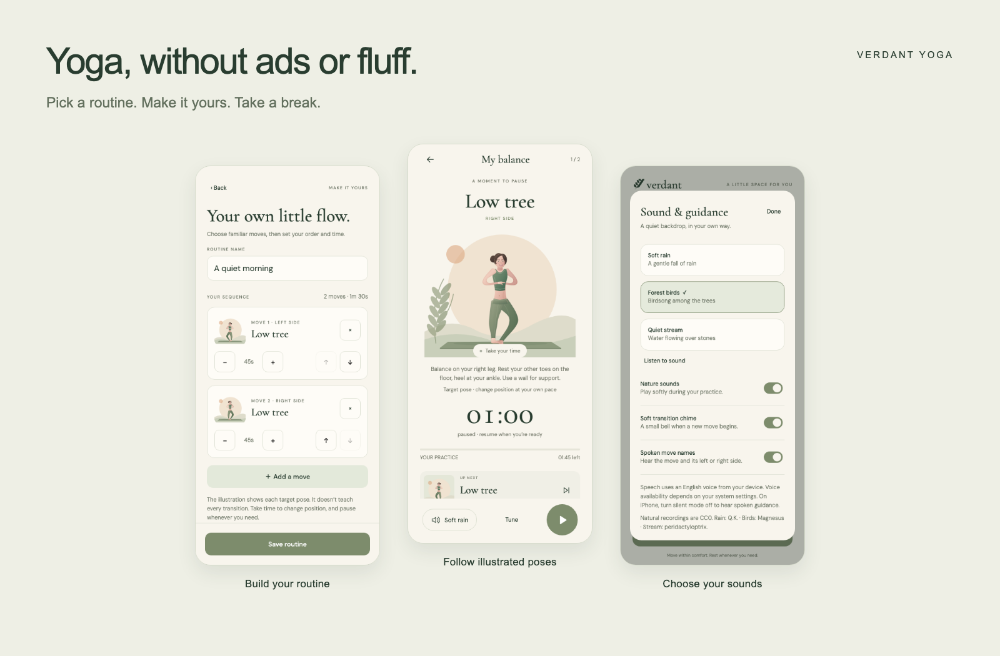

# Verdant Yoga

**Yoga, without ads or fluff.**

A low-distraction way to take a break, stretch, and relax. Pick a routine or build your own, follow the illustrated poses, and keep the sound as simple as you like. No ads, accounts, subscriptions, or social feed.



## What it does

- **Six ready-made routines:** Morning flow (10 min), Gentle stretch (15 min), Evening unwind (12 min), Find your balance (6 min), Seated softness (7 min), and A little reset (5 min).
- **Build your own:** choose from 19 moves, including left/right variants; reorder or repeat them; set holds from 15 to 180 seconds. Save, edit, and delete routines on your device, with up to 30 moves per routine.
- **Follow your practice:** illustrated target poses, short text cues, side labels, a countdown, overall progress, and a preview of the next move. Pause, skip, or stop at any time.
- **Choose your sound:** real rain, forest birds, or a quiet stream; an optional soft transition bell; and optional spoken move names and sides using your device's text-to-speech engine.
- **Keep interruptions down:** practice pauses when the app goes into the background. Nature sounds become quieter while a move is announced. Reduced Motion is supported.

Built with Expo SDK 57, React Native, and TypeScript for Android, iOS, and web. The ivory/sage interface uses original SVG illustrations of one recurring character across 14 pose shapes: long, warm-brown hair with curtain bangs, freckles, rosy cheeks, green eyes, small silver hoops, a cream-and-green Breton tee and blue leggings. Under **Sound & guidance → Character** you can switch off the open smile (for a softer closed one), swap the stripes for a plain green sports shirt, and put her hair up in a bun.

## Local storage and offline use

Saved routines and sound preferences stay in local app storage. There is no account or cloud sync. Active sessions reset when the app reloads, and practice history is not saved.

The native app bundles its poses, fonts, and nature recordings, so those features work without a content service after installation. Optional speech depends on the installed voice engine and voice packs, which may require a network connection. On iPhone, turn silent mode off to hear speech. The web preview is not an offline PWA.

Illustrations show target poses, not detailed instruction for moving between every possible pair. Speech announces names and sides rather than providing full coaching. Change position at your own pace and pause when needed.

## Run locally

Use Node.js 22.13 or later and npm.

```sh
npm ci
npm run web
```

For native development:

```sh
npm start
# With the relevant Android/iOS development tooling installed:
npm run android
npm run ios
```

Use an Expo Go version compatible with SDK 57, or a local development build. Native builds require Android Studio/Android SDK or Xcode respectively. Read the [versioned Expo 57 documentation](https://docs.expo.dev/versions/v57.0.0/) when changing Expo APIs.

## Build an Android test APK

```sh
./scripts/build_android.sh
```

The script runs Expo prebuild and Gradle, then writes `releases/verdant-yoga-<version>.apk`. It refuses to overwrite an existing APK. Its defaults use Android Studio's bundled Java and the usual macOS SDK location; set `JAVA_HOME` and `ANDROID_HOME` for other installations. Android SDK Build Tools 36.0.0 is used for signature verification.

The current app version is **1.3.0**, Android version code **4**, package `com.verdant.yoga`, targeting Android 7.0/API 24 or newer. This standalone test APK includes the JavaScript and assets and does not require Expo Go or a development server.

The build currently uses Expo's default debug signing certificate in a non-debuggable release configuration. It is for personal testing, not configured for Play Store distribution. Set up your own private release signing before publishing. APKs, signing keys, and build intermediates are excluded from this repository.

## Validation

```sh
npm run typecheck
npx expo-doctor
npx playwright install chromium
# In another terminal:
npx expo start --web --port 8081
# Then:
npm test
# Optional platform bundle checks:
npx expo export --platform all
```

The 1.3.0 implementation passed 23 Playwright/controller/geometry tests, TypeScript checks, and all 21 Expo Doctor checks. Coverage includes routine timing, pause/resume, saved routine editing and persistence, audio switching, speech cancellation during voice-engine initialization, side announcements, ambient ducking, and SVG transition stability. Android assembly and iOS/web exports succeeded; the APK signature, alignment, and bundled audio hashes were verified.

Movement was captured in 36 live-app scenarios covering every distinct preset transition plus custom side changes and floor reversals, with no browser page errors. Representative previews were refreshed after the final easing and elbow changes. Screens were reviewed at phone-sized browser viewports. Physical-device installation, voice engines, audio interruptions, speaker listening, and iOS native behavior still need handset testing. An iOS JavaScript export is not an iOS native build. The README image is composed from actual app browser screenshots.

## Movement

Supported transitions are animated on a small 3D skeleton seen through an orthographic camera ([`src/rig.ts`](src/rig.ts)). Bones keep their true length in 3D, so a knee that bends toward you foreshortens instead of swinging sideways across the picture, and knees always bend over the toes. Each body part (pelvis and legs, spine and head, arms, camera) follows its own keyframes on a monotone cubic curve, so movement flows through consecutive cues without stopping or overshooting a joint, and starts and ends at rest. A foot or hand is planted only between keys that hold it still, and the solver lowers the pelvis rather than overstretching a planted leg.

Standing routes connect Mountain, Upward reach, Chair, Standing fold, Low tree, Warrior II, and Triangle ([`src/motion.ts`](src/motion.ts)). Arms sweep up through the sides; Chair and the fold turn the view to three-quarters while she sits back or hinges, and Upward reach → fold is a swan dive. Low tree shifts weight, lifts the foot to the ankle with the knee turned out, and gathers the palms to the heart along the midline. Warrior II and Triangle are reached with two side steps into a centred wide stance before the front foot pivots out; side changes pivot both feet in place instead of stepping back to Mountain. Tabletop ↔ Child’s pose eases back, walks one hand forward at a time, then rests toward the heels. Long hair hangs with gravity, so it drapes in a fold and pools on the mat in Child’s pose.

Movement takes extra time before each full pose hold. The routine duration describes **holds**, with position changes added. Pausing freezes the exact movement frame; resuming continues it. A skip requested during movement waits for the supported endpoint before continuing to the queued pose. Spoken names and chimes occur on arrival. Reduced Motion displays the target without animated travel.

The choreography does not cover standing-to-floor changes, lunges, or transitions involving seated/reclined poses. Those changes show the target and wait for **I’m in position**, preserving the complete hold time. This is a deliberate limit: an arbitrary body morph cannot demonstrate a plausible roll or change of support. The artwork remains a stylized guide, not a full biomechanical simulation.

Motion tests check, for every selectable pair, true 3D bone lengths, planted contacts that never slide, nothing passing through the mat, knees that track the toes, elbows that never fold inward, swing feet that clear the mat while the pelvis stays over the standing foot, and phases that join without jumps or jerks. Timeline tests cover hold timing, queued skips, pauses, backgrounding, and reduced motion. `scripts/capture_motion.cjs` creates sampled sequences and GIF/MP4 previews; `MOTION_ALL=1` includes every distinct transition in the six presets. Visual review is performed on the movements, not only final poses.

## Assets and credits

- Original SVG artwork: [`src/Illustration.tsx`](src/Illustration.tsx) and [`src/figure.ts`](src/figure.ts).
- Nature recordings: individually verified CC0 recordings by Q.K., Magnesus, and peridactyloptrix. Source links, processing details, and reproduction steps are in [`AUDIO_CREDITS.md`](AUDIO_CREDITS.md).
- Transition bell: synthesized for this app; reproduced by `scripts/generate_chime.py`.
- Fonts: Cormorant Garamond and DM Sans, distributed through their Google Fonts packages with the included licenses.
- The existing [`LICENSE`](LICENSE) contains the Expo starter's MIT notice and is retained unchanged. Third-party assets retain their respective terms.
