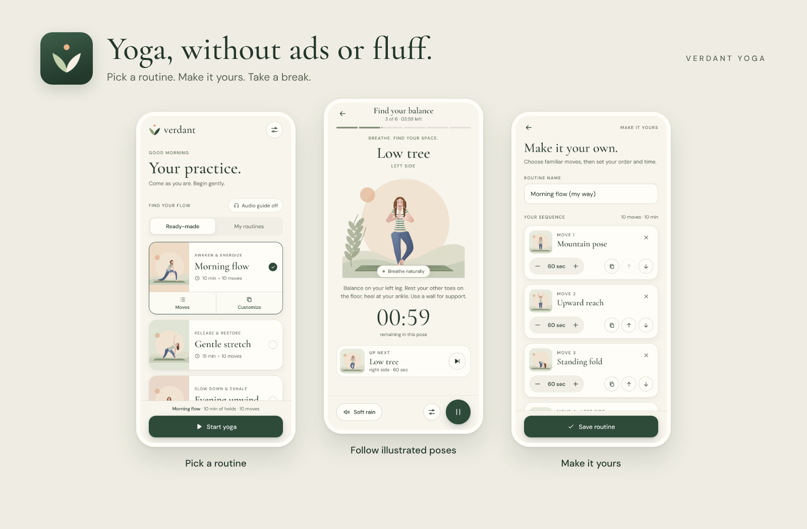

# Verdant Yoga

**Yoga, without ads or fluff.**

A low-distraction way to take a break, stretch, and relax. Pick a routine or build your own, follow the illustrated poses or let a calm voice guide you with your screen off, and keep the sound as simple as you like. No ads, accounts, subscriptions, or social feed.



## What it does

- **Six ready-made routines:** Morning flow (10 min), Gentle stretch (15 min), Evening unwind (12 min), Find your balance (6 min), Seated softness (7 min), and A little reset (5 min).
- **Build your own:** choose from 19 moves, including left/right variants; reorder or repeat them; set holds from 15 to 180 seconds. Save, edit, and delete routines on your device, with up to 30 moves per routine.
- **Follow your practice:** illustrated target poses, short text cues, side labels, a countdown, overall progress, and a preview of the next move. Pause, skip, or stop at any time.
- **Audio guide:** a voice leads you from pose to pose, so you can practise with your screen off. Choose **Detailed** guidance, which describes how to move into each pose and what to notice while holding it, or **Brief** guidance, which only names the next move ("Next, warrior two, right side."). Use your device's own voice, or install a natural-sounding [Paradee](https://github.com/sahilmahendrakar/paradee) voice with one tap.
- **Choose your sound:** real rain, forest birds, or a quiet stream, and an optional soft bell when it's time to change pose.
- **Keep interruptions down:** without the audio guide, practice pauses when the app goes into the background. Nature sounds become quieter while the guide speaks. Reduced Motion is supported.
- **One settings screen:** the audio guide, voices, sound and the character's look are all under **Settings** (the sliders icon on the home screen and during practice), separate from the routine builder.

Built with Expo SDK 57, React Native, and TypeScript for Android, iOS, and web. The ivory/sage interface uses original SVG illustrations of one recurring character across 14 pose shapes: long, warm-brown hair with curtain bangs, freckles, rosy cheeks, green eyes, small silver hoops, a cream-and-green Breton tee and blue leggings. Under **Settings → Character** you can switch off the open smile (for a softer closed one), swap the stripes for a plain green sports shirt, and put her hair up in a bun.

## Local storage and offline use

Saved routines, settings and installed voices stay on the device. There is no account or cloud sync. Active sessions reset when the app reloads, and practice history is not saved.

The native app bundles its poses, fonts, and nature recordings, so those features work without a content service after installation. A Paradee voice is downloaded only when you tap **Install** (3.3 to 4 MB) and then works offline. The device voice depends on the installed text-to-speech engine, which may itself need a download. On iPhone, turn silent mode off to hear the guide. The web preview is not an offline PWA; there, installed voices are kept in the browser's cache storage.

Illustrations show target poses, not detailed instruction for moving between every possible pair. The audio guide describes how to come into each pose; move within comfort and pause when needed.

## Audio guide

Turn it on under **Settings → Audio guide**. The guide:

- welcomes you, describes the first pose and, with detailed guidance, what to notice while holding it;
- rings the transition bell (if on) when a hold ends, then describes or names the next pose, and says when the same pose switches to the other side;
- gives a few breaths' notice before a longer hold (30 seconds or more) ends, with detailed guidance;
- talks you through changes of position that the illustrations do not animate, then starts the hold on its own after a moment to settle (a few seconds after it finishes speaking), so you never need to tap **I'm in position** with the screen off;
- says a few closing words before the completion screen.

With the guide on, practice keeps going when you lock the screen or switch apps. The phone stays awake only when the guide is off. A continuously playing audio session (the nature sound, or silence when sounds are off) keeps the app running in the background, and the lock screen shows the current pose with play and pause. Pausing from the lock screen or headphones pauses the practice.

Every line the guide can say lives in [`src/guideScript.ts`](src/guideScript.ts) with a stable id. Recordings are only used when their text matches the script exactly, so after any wording change the outdated lines are read by the device voice until the packs are regenerated. If a recording cannot be played, the device voice reads that line instead; if the device voice fails too, the practice shows a short hint and carries on.

### Voice packs

Each Paradee voice is pre-rendered once, line by line, rather than running a speech model on the phone: playback is reliable in the background, there is no native machine-learning runtime, and the same packs work on the web. Packs live in [`voices/paradee-1.2`](voices/paradee-1.2): one mono AAC file per line plus a `manifest.json` with each line's text, size and SHA-256. The app downloads them from this repository's `main` branch (`raw.githubusercontent.com`); set `EXPO_PUBLIC_VOICE_BASE_URL` at build time to host them elsewhere. Installing writes the manifest last, so an interrupted download never counts as installed, and every file's size is checked.

To regenerate the packs after changing the script (Python 3.10 to 3.13 and ffmpeg):

```sh
python3.11 -m venv .venv
.venv/bin/pip install "git+https://github.com/sahilmahendrakar/paradee" soundfile
node scripts/export_guide_lines.cjs > lines.json
.venv/bin/python scripts/generate_voices.py lines.json voices/paradee-1.2
```

Only changed lines are rendered again. Commit the updated `voices/` folder with the script change, and update the sizes in [`src/voices.ts`](src/voices.ts) if they move; a test checks every pack against the script.

## Run locally

Use Node.js 22.13 or later and npm.

```sh
npm ci
npm run web
```

For native development:

```sh
npm start
# With the relevant Android/iOS development tooling installed:
npm run android
npm run ios
```

Use an Expo Go version compatible with SDK 57, or a local development build. Native builds require Android Studio/Android SDK or Xcode respectively. Read the [versioned Expo 57 documentation](https://docs.expo.dev/versions/v57.0.0/) when changing Expo APIs.

## Build an Android test APK

```sh
./scripts/build_android.sh
```

The script runs Expo prebuild and Gradle, then writes `releases/verdant-yoga-<version>.apk`. It refuses to overwrite an existing APK. Its defaults use Android Studio's bundled Java and the usual macOS SDK location; set `JAVA_HOME` and `ANDROID_HOME` for other installations. Android SDK Build Tools 36.0.0 is used for signature verification.

The current app version is **1.4.0**, Android version code **5**, package `com.verdant.yoga`, targeting Android 7.0/API 24 or newer. This standalone test APK includes the JavaScript and assets and does not require Expo Go or a development server.

The build currently uses Expo's default debug signing certificate in a non-debuggable release configuration. It is for personal testing, not configured for Play Store distribution. Set up your own private release signing before publishing. APKs, signing keys, and build intermediates are excluded from this repository.

## Build for iPhone

The iOS bundle identifier is `com.tjebbehb.verdantyoga` (team `2RD8HX7BRW`). Run `npx expo prebuild --platform ios`, then `pod install` in `ios/` with a UTF-8 locale (`LANG=en_US.UTF-8`), and archive the `VerdantYoga` scheme in Xcode. `plugins/withQuotedScriptPaths.js` quotes two generated build-script paths that otherwise break on the space in this folder's name. TestFlight uploads need an App Store Connect app record for the bundle identifier.

## Validation

```sh
npm run typecheck
npx expo-doctor
npx playwright install chromium
# In another terminal:
npx expo start --web --port 8081
# Then:
npm test
# Optional platform bundle checks:
npx expo export --platform all
```

The 1.3.0 implementation passed 23 Playwright/controller/geometry tests, TypeScript checks, and all 21 Expo Doctor checks. Coverage includes routine timing, pause/resume, saved routine editing and persistence, audio switching, speech cancellation during voice-engine initialization, side announcements, ambient ducking, and SVG transition stability. Android assembly and iOS/web exports succeeded; the APK signature, alignment, and bundled audio hashes were verified.

The audio guide adds nine tests: every move has lines in both styles, timeline changes map to the right moments, the voice sequence plays recordings, falls back to the device voice and cancels cleanly, every voice pack matches the script, and in the browser a voice installs, previews and is removed, a guided practice carries on with the page hidden and ends after its closing words, recordings play with the device voice standing in for a damaged one, and a change of position continues on its own. The full suite of 30 tests passes. Background playback with a locked screen, lock-screen controls, and Paradee playback on phones still need testing on a handset.

Movement was captured in 36 live-app scenarios covering every distinct preset transition plus custom side changes and floor reversals, with no browser page errors. Representative previews were refreshed after the final easing and elbow changes. Screens were reviewed at phone-sized browser viewports. Physical-device installation, voice engines, audio interruptions, speaker listening, and iOS native behavior still need handset testing. An iOS JavaScript export is not an iOS native build. The README image is composed from actual app browser screenshots.

## Movement

Supported transitions are animated on a small 3D skeleton seen through an orthographic camera ([`src/rig.ts`](src/rig.ts)). Bones keep their true length in 3D, so a knee that bends toward you foreshortens instead of swinging sideways across the picture, and knees always bend over the toes. Each body part (pelvis and legs, spine and head, arms, camera) follows its own keyframes on a monotone cubic curve, so movement flows through consecutive cues without stopping or overshooting a joint, and starts and ends at rest. A foot or hand is planted only between keys that hold it still, and the solver lowers the pelvis rather than overstretching a planted leg.

Standing routes connect Mountain, Upward reach, Chair, Standing fold, Low tree, Warrior II, and Triangle ([`src/motion.ts`](src/motion.ts)). Arms sweep up through the sides; Chair and the fold turn the view to three-quarters while she sits back or hinges, and Upward reach → fold is a swan dive. Low tree shifts weight, lifts the foot to the ankle with the knee turned out, and gathers the palms to the heart along the midline. Warrior II and Triangle are reached with two side steps into a centred wide stance before the front foot pivots out; side changes pivot both feet in place instead of stepping back to Mountain. Tabletop ↔ Child’s pose eases back, walks one hand forward at a time, then rests toward the heels. Long hair hangs with gravity, so it drapes in a fold and pools on the mat in Child’s pose.

Movement takes extra time before each full pose hold. The routine duration describes **holds**, with position changes added. Pausing freezes the exact movement frame; resuming continues it. A skip requested during movement waits for the supported endpoint before continuing to the queued pose. The bell and the audio guide's description of the next pose begin as the movement starts. Reduced Motion displays the target without animated travel.

The choreography does not cover standing-to-floor changes, lunges, or transitions involving seated/reclined poses. Those changes show the target and wait for **I’m in position** (or, with the audio guide on, for the guide to finish describing the change and a moment to settle), preserving the complete hold time. This is a deliberate limit: an arbitrary body morph cannot demonstrate a plausible roll or change of support. The artwork remains a stylized guide, not a full biomechanical simulation.

Motion tests check, for every selectable pair, true 3D bone lengths, planted contacts that never slide, nothing passing through the mat, knees that track the toes, elbows that never fold inward, swing feet that clear the mat while the pelvis stays over the standing foot, and phases that join without jumps or jerks. Timeline tests cover hold timing, queued skips, pauses, backgrounding, and reduced motion. `scripts/capture_motion.cjs` creates sampled sequences and GIF/MP4 previews; `MOTION_ALL=1` includes every distinct transition in the six presets. Visual review is performed on the movements, not only final poses.

## Assets and credits

- Original SVG artwork: [`src/Illustration.tsx`](src/Illustration.tsx) and [`src/figure.ts`](src/figure.ts).
- Nature recordings: individually verified CC0 recordings by Q.K., Magnesus, and peridactyloptrix. Source links, processing details, and reproduction steps are in [`AUDIO_CREDITS.md`](AUDIO_CREDITS.md).
- Transition bell: synthesized for this app; reproduced by `scripts/generate_chime.py`.
- Guide voices: rendered with [Paradee](https://github.com/sahilmahendrakar/paradee) by Sahil Mahendrakar (Apache-2.0), an 8M-parameter model distilled from Kokoro-82M (Apache-2.0), using its Heart, Isabella, Puck and Fable voices; reproduced by `scripts/generate_voices.py`.
- Fonts: Cormorant Garamond and DM Sans, distributed through their Google Fonts packages with the included licenses.
- The existing [`LICENSE`](LICENSE) contains the Expo starter's MIT notice and is retained unchanged. Third-party assets retain their respective terms.
